# University Explorer Portal

## Overview

The University Explorer Portal is a Blazor web application developed for the Full Stack Development CA2 assignment.

The application combines country and university APIs to allow users to explore countries and their universities. It also integrates with the Student Application API to retrieve, create and edit student applications.

## Technologies

- C#
- Blazor
- .NET
- Razor Components
- HTML and CSS
- REST APIs
- JSON
- HttpClient
- DataAnnotations

## API Integration

### Country and University Data

The application retrieves country information and related universities from external APIs.

### Student Application API

**Endpoint:** https://edutots.net/api/studentapplication

The application implements the following HTTP operations:

| Method | Purpose |
|---|---|
| GET | Retrieve student applications |
| POST | Create a student application |
| PUT | Update an existing student application |

## Features

- Displays countries in a dropdown list.
- Shows country name, capital, region, population and flag.
- Retrieves universities associated with the selected country.
- Searches universities by name.
- Displays university details, including country, website and domain.
- Retrieves and displays student applications.
- Creates student applications with form validation.
- Edits existing student applications.
- Displays loading states.
- Uses reusable Razor components.

## Component Structure

| Component | Responsibility |
|---|---|
| `CountryDetails.razor` | Displays selected country information |
| `UniversityCard.razor` | Displays a university in the results |
| `UniversityDetails.razor` | Displays selected university details |
| `StudentApplicationForm.razor` | Provides the student application form |

## Screenshots

### Home Page

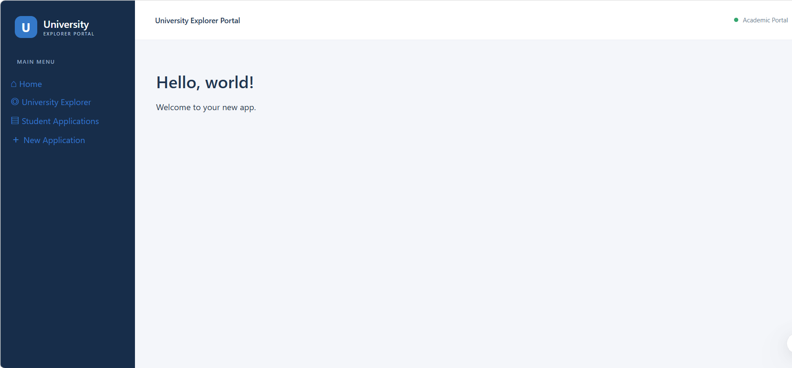

### University Explorer

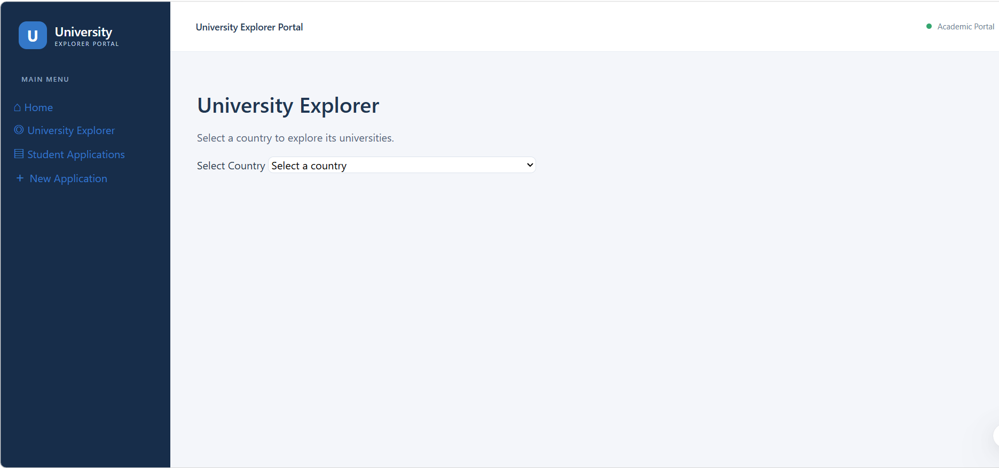

### Country Selection

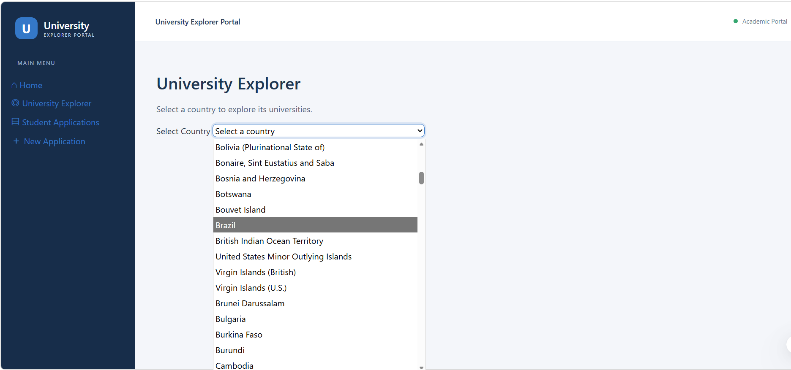

### Country Details and Universities

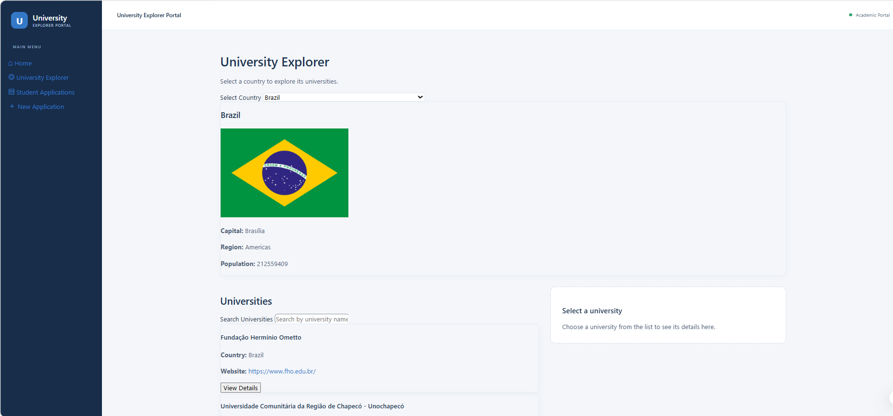

### University Search

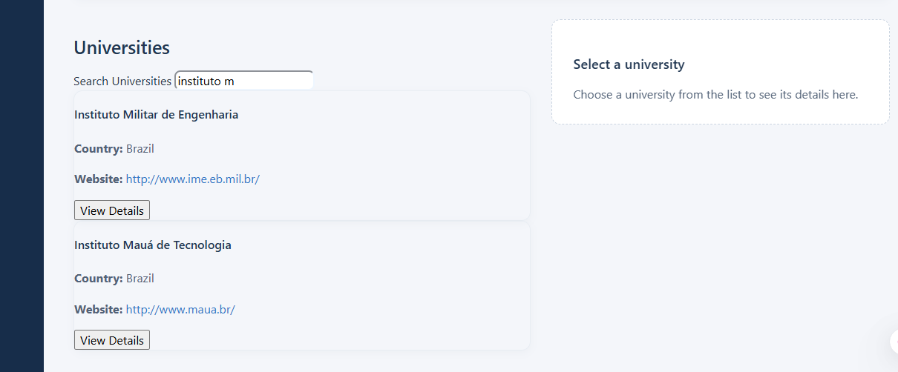

### University Details

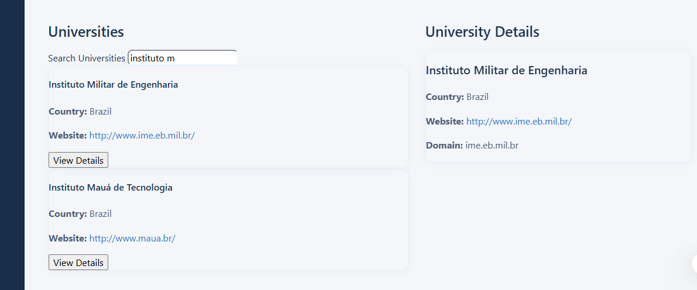

### Student Applications

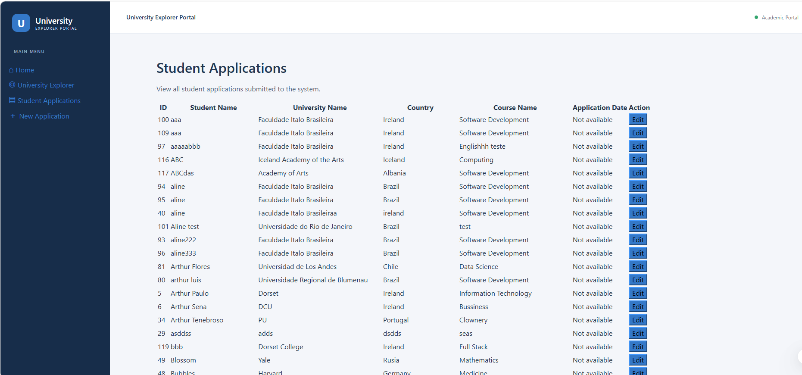

### Edit Student Application

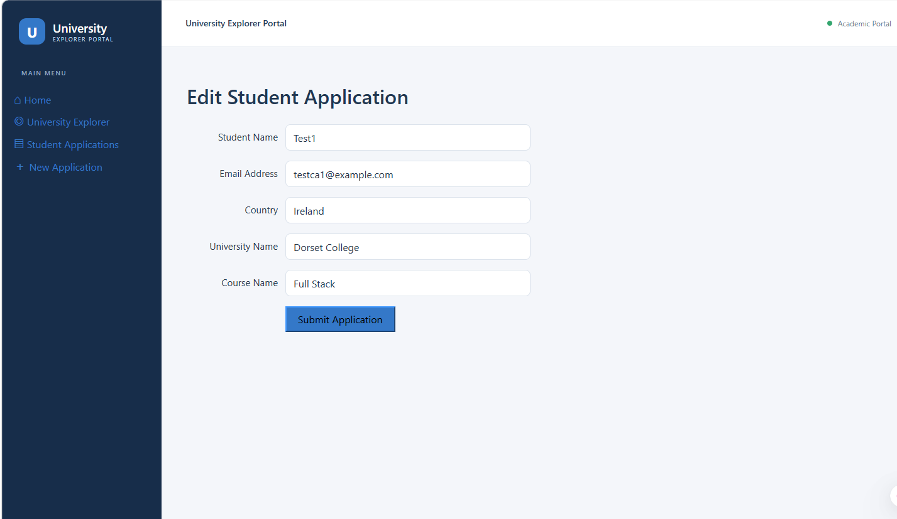

### Create Student Application

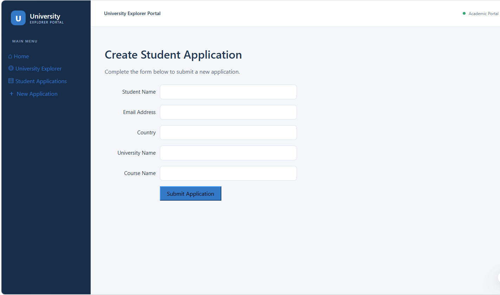

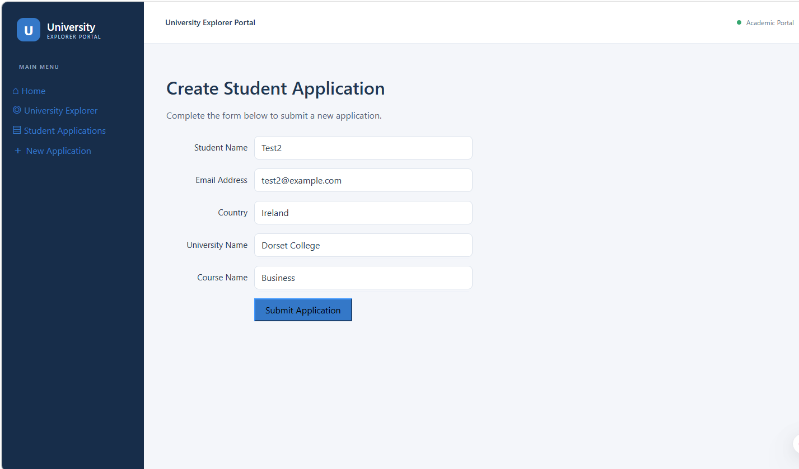

### Form Validation

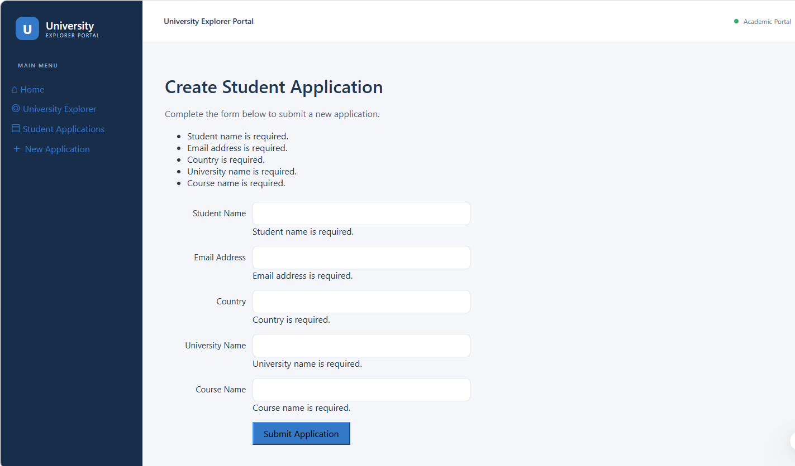

### Loading State

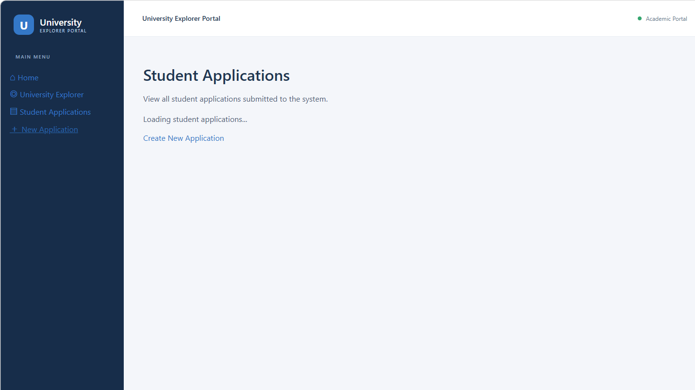

## How to Run the Application

### Requirements

- Visual Studio 2022
- .NET SDK
- Internet connection to access the APIs

### .NET CLI

Run these commands from the repository root:

```powershell
dotnet restore .\UniversityExplorer\UniversityExplorer.csproj
dotnet run --project .\UniversityExplorer\UniversityExplorer.csproj
```

Open the local URL displayed in the terminal.

## Repository

GitHub repository:

https://github.com/tfsousa1/fsd1-ca2-university-explorer-76192
